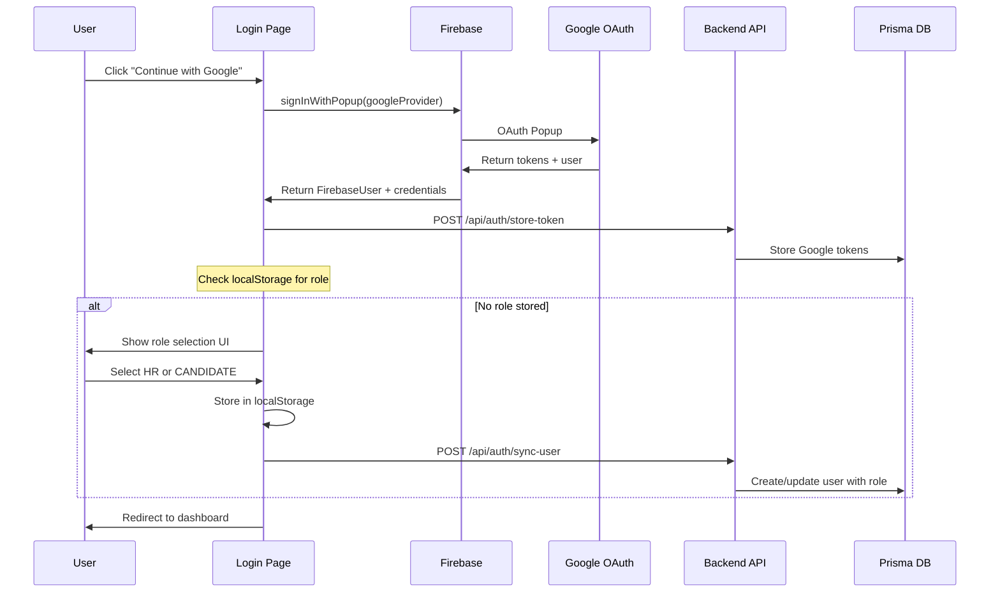

# Authentication Setup - HR Tech Platform

This document explains the complete authentication flow and architecture of the HR Tech application.

---

## Overview

The application uses a **hybrid authentication approach**:

| Component | Technology |
|-----------|------------|
| **Primary Auth** | Firebase Authentication (Google OAuth) |
| **Role Management** | Local storage + Prisma database |
| **Token Storage** | Google OAuth tokens stored in database |

---

## Architecture Diagram

```mermaid
flowchart TD
    subgraph Frontend
        A[Login Page] --> B{User clicks Google Sign In}
        B --> C[Firebase signInWithPopup]
        C --> D[Google OAuth Popup]
        D --> E[Firebase User Created]
        E --> F{Role exists?}
        F -->|No| G[Show Role Selection UI]
        F -->|Yes| H[Redirect to Dashboard]
        G --> I[User Selects HR or CANDIDATE]
        I --> J[Store Role in LocalStorage]
        J --> K[Sync to Database API]
        K --> H
    end

    subgraph Backend
        K --> L[/api/auth/sync-user]
        L --> M[Verify Firebase Token]
        M --> N[Create/Update User in Prisma DB]
        
        C --> O[/api/auth/store-token]
        O --> P[Store Google OAuth Tokens]
    end
```

---

## Key Files

### 1. [firebase.ts](file:///c:/Users/Arnv/New%20folder%20(25)/app/firebase.ts)
**Firebase Configuration & Google OAuth Setup**

- Initializes Firebase app with environment variables
- Creates `auth` instance and `googleProvider`
- Adds OAuth scopes for Gmail, Calendar, and user info
- Forces token refresh on every login with `access_type: 'offline'` and `prompt: 'consent'`

```typescript
// Scopes requested from Google
googleProvider.addScope('https://www.googleapis.com/auth/gmail.readonly');
googleProvider.addScope('https://www.googleapis.com/auth/gmail.send');
googleProvider.addScope('https://www.googleapis.com/auth/calendar');
googleProvider.addScope('https://www.googleapis.com/auth/userinfo.email');
```

---

### 2. [AuthContext.tsx](file:///c:/Users/Arnv/New%20folder%20(25)/lib/auth/AuthContext.tsx)
**Central Auth State Manager**

Provides these values to the entire app:

| Value | Type | Description |
|-------|------|-------------|
| `user` | `FirebaseUser \| null` | Firebase user object |
| `dbUser` | `DbUser \| null` | Database user with role |
| `role` | `'HR' \| 'CANDIDATE' \| null` | Current user role |
| `loading` | `boolean` | Auth state loading |
| `error` | `string \| null` | Auth error message |

**Key Functions:**
- `setRole(role)` - Stores role in localStorage and syncs to DB
- `syncUser()` - Syncs Firebase user to database
- `signOut()` - Signs out and clears all auth state
- `refreshUser()` - Refreshes user data from database

**Role Storage Strategy:**
```
localStorage key: `hrtech_user_role_{firebase_uid}`
```

---

### 3. [AuthProvider.tsx](file:///c:/Users/Arnv/New%20folder%20(25)/components/AuthProvider.tsx)
**Simple Wrapper Component**

Wraps `AuthContextProvider` for use in layout.

---

### 4. [layout.tsx](file:///c:/Users/Arnv/New%20folder%20(25)/app/layout.tsx)
**Root Layout**

Wraps entire app with `<AuthProvider>` so all pages have access to auth context.

---

### 5. [login/page.tsx](file:///c:/Users/Arnv/New%20folder%20(25)/app/login/page.tsx)
**Login Page Component**

**Two UI States:**

1. **Initial State** - Shows Google Sign In button
2. **Role Selection** - Shows after login if no role exists

**Login Flow:**
```typescript
1. User clicks "Continue with Google"
2. signInWithPopup(auth, googleProvider) opens OAuth popup
3. On success, extract tokens from result
4. Store Google tokens via /api/auth/store-token
5. AuthContext detects login, checks for stored role
6. If no role → show role selection UI
7. User selects HR or CANDIDATE
8. setRole() stores in localStorage + syncs to DB
9. Redirect to appropriate dashboard
```

**Role-based Redirects:**
- HR → `/dashboard`
- CANDIDATE → `/jobopening`

---

### 6. [/api/auth/sync-user/route.ts](file:///c:/Users/Arnv/New%20folder%20(25)/app/api/auth/sync-user/route.ts)
**User Sync API Endpoint**

- Verifies Firebase ID token from Authorization header
- Creates or updates user in Prisma database
- Returns user object with role

> [!WARNING]
> Token verification is simplified (JWT decode only). Production should use `firebase-admin` for full verification.

---

### 7. [/api/auth/store-token/route.ts](file:///c:/Users/Arnv/New%20folder%20(25)/app/api/auth/store-token/route.ts)
**Google OAuth Token Storage API**

Stores Google OAuth tokens for:
- Background email access (Gmail API)
- Calendar integration

---

## User Roles

| Role | Value | Dashboard | Use Case |
|------|-------|-----------|----------|
| HR Professional | `'HR'` | `/dashboard` | Post jobs, manage applications |
| Job Seeker | `'CANDIDATE'` | `/jobopening` | Browse and apply for jobs |

---

## Authentication Flow Diagram



---

## Environment Variables Required

```env
# Firebase (Public - exposed to client)
NEXT_PUBLIC_FIREBASE_API_KEY=
NEXT_PUBLIC_FIREBASE_AUTH_DOMAIN=
NEXT_PUBLIC_FIREBASE_PROJECT_ID=
NEXT_PUBLIC_FIREBASE_STORAGE_BUCKET=
NEXT_PUBLIC_FIREBASE_MESSAGING_SENDER_ID=
NEXT_PUBLIC_FIREBASE_APP_ID=
NEXT_PUBLIC_FIREBASE_MEASUREMENT_ID=
```

---

## Key Design Decisions

### 1. Local Storage First for Roles
Roles are stored in `localStorage` first, then synced to DB. This allows:
- Faster role checking on page load
- Works even if database is unavailable
- New users always see role selection

### 2. Google OAuth Scopes
The app requests extended scopes for:
- **Gmail Read** - For email integration in dashboard
- **Gmail Send** - For sending emails from HR dashboard
- **Calendar** - For scheduling/interview management
- **User Info** - For profile display

### 3. Force Token Refresh
```typescript
googleProvider.setCustomParameters({
    access_type: 'offline',
    prompt: 'consent'
});
```
This ensures fresh tokens are captured on every login for API access.

---

## How to Use Auth in Components

```tsx
'use client';

import { useAuth } from '@/lib/auth/AuthContext';

export function MyComponent() {
    const { user, role, loading, signOut } = useAuth();
    
    if (loading) return <div>Loading...</div>;
    
    if (!user) return <div>Please log in</div>;
    
    return (
        <div>
            <p>Welcome, {user.displayName}</p>
            <p>Role: {role}</p>
            <button onClick={signOut}>Sign Out</button>
        </div>
    );
}
```

---

## Summary

The auth system consists of:

1. **Firebase** handles Google OAuth and session management
2. **AuthContext** provides React context for auth state
3. **localStorage** stores user role for quick access
4. **Prisma DB** persists user data and Google tokens
5. **API Routes** handle token verification and user sync

This setup allows for a seamless login experience with role-based access control.
